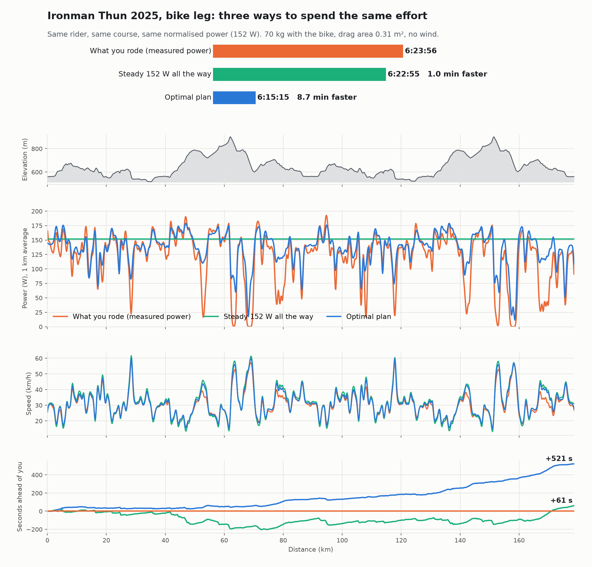

# Cycling optimal control

How should a cyclist spread their effort over a course to finish as fast as possible?
This project answers that with a physics model of the bike and two optimal-control
solvers, then applies it to Tour de France time trials and to recorded rides.



## What is here

| Path | What it is |
|---|---|
| `ttopt/` | The library: bike model, direct collocation (CasADi + IPOPT), dynamic programming (numba), course loaders, comparison with real rides |
| `app/` | A local web app: enter your numbers, drop a GPX file, get a pacing plan |
| `time_trial_pacing.ipynb` | The full study as a notebook (`.html` is the executed export) |
| `scripts/` | Reproduction scripts for the notebook, the pro-rider comparison and the triathlon analysis |
| `tests/` | 24 tests, including cross-checks between the two solvers |
| `figures/` | Rendered results |

## Quick start

```bash
python3.12 -m venv .venv
.venv/bin/pip install -r requirements.txt
.venv/bin/python -m pytest tests -q
.venv/bin/python app/server.py        # opens http://127.0.0.1:8309
```

```python
from ttopt import Cyclist, courses, solve

rider = Cyclist(mass=78, cda=0.22, cp=410, w_prime=20_000)
plan = solve(rider, courses.single_hill(), method="collocation")   # or "dp", "constant"
print(plan.summary())
```

## The model

- **Bike:** a point mass along the road, with air drag, rolling resistance, gravity,
  a wheel-force cap, braking and corner speed limits. Each stretch of road satisfies an
  energy balance exactly, so gravity is never lost to discretisation.
- **Rider:** critical power (sustainable indefinitely) plus a finite reserve of work above
  it. By default the reserve is spent once and never refills. Two alternative effort rules
  are available for comparison with recordings: a reserve that refills below critical
  power, and a cap on normalised power.
- **Solvers:** direct collocation solves one nonlinear programme for the whole ride;
  dynamic programming works backwards on a (speed, reserve) grid. They agree to within a
  fraction of a second on the test courses; collocation is about ten times faster.

## Main results

- On a 10 km course with a 2 km climb at 7 %, the optimal plan beats constant power by
  about 15 s for a 410 W rider.
- Monaco → Nice (Tour de France 2024, stage 21) and Passy → Combloux (2023, stage 16):
  optimal plans for the course, and a comparison with riders' official split times. The
  estimated gains (a few seconds to about half a minute for the best riders) are within
  the uncertainty of the unknown drag area.
- Michael Hepburn's power file from the 2018 Tour time trial: the model replays his
  measured power to within 5 s along the course. At equal normalised power the optimal
  plan is about 20 s faster.
- Three triathlon bike legs from one amateur rider: 4 to 9 minutes available at equal
  normalised power, mostly from pedalling on gentle descents and riding the flats more
  evenly.

## Data and credits

- Course tracks are rebuilt from public race GPX files (cyclingstage.com) with elevation
  from the IGN RGE ALTI terrain model; see `data/raw/README_tracks.txt`.
- Split times are the official race results.
- The Hepburn power data was published by TrainingPeaks. It is not redistributed here;
  `data/raw/powerfile/README.txt` says where it came from.
- Personal ride recordings used by `scripts/triathlon_races.py` and
  `scripts/versailles_70_3.py` are not included; those scripts need your own files.

## Limits

The model has no wind gusts, no drafting and no fatigue beyond the reserve. Gains
estimated from split times or GPS alone depend strongly on the assumed drag area and
mass. Critical power is not sustainable for efforts much longer than an hour: for long
events, enter the power you can hold for that duration.
